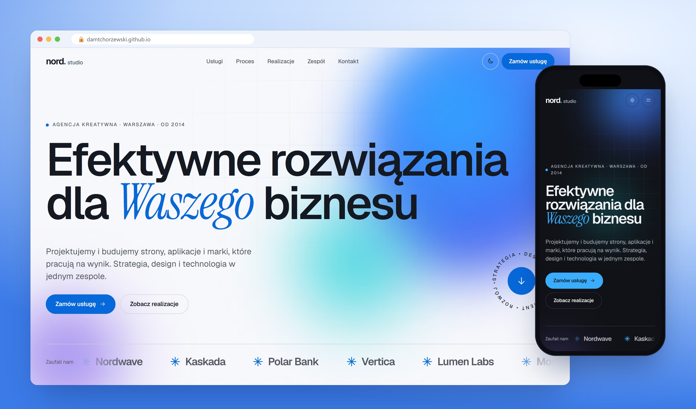
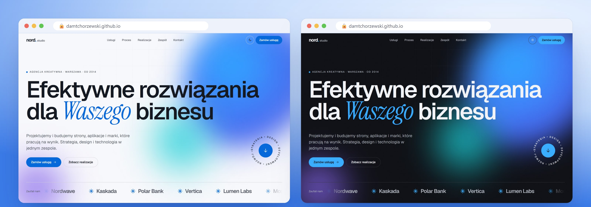
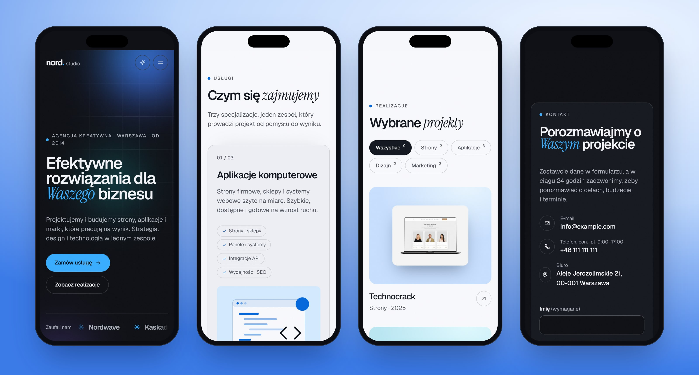

<p align="center">
  <picture>
    <source media="(prefers-color-scheme: dark)" srcset="docs/images/banner-dark.png">
    
  </picture>
</p>

<p align="center">
  
</p>

## About

<a href="https://damtchorzewski.github.io/creative-agency-website/"></a>

**Nord Studio** is a scroll-driven website of a fictional creative agency from Warsaw: one long page that tells the
story from the first impression to the contact form, plus a case-study page for each of the nine projects. It is the
rebuilt successor of [digital-agency-website](https://github.com/DamTchorzewski/digital-agency-website), which stays
as it was. The people, clients, numbers and contact details are made up (`example.com`, `+48 111 111 111`).

- **Scroll story.** Hero with a headline that rises word by word, a manifesto that lights up as you scroll, a studio
  photo that opens up, service cards that stack, a pinned horizontal process on wide screens, counters, the
  portfolio, the team and the contact section.
- **Motion that respects the visitor.** GSAP (ScrollTrigger, SplitText) and Lenis smooth scrolling load after the
  first paint and only with `prefers-reduced-motion: no-preference`; smooth scrolling, the cursor bubble and the
  magnetic buttons only with a mouse. With reduced motion every block is simply there.
- **Portfolio with working filters.** Category buttons (`aria-pressed`) with an announced count in Polish plural
  forms, and a view transition from a project card to its case study (`/projekty/<slug>/`).
- **Forms without a backend.** The order form (in the contact section and in a dialog) and the newsletter validate
  with messages next to the fields, focus the first error and announce the result; they say that the site is a demo.
- **Light and dark theme.** Follows the system, with a toggle that remembers the choice and no flash on load.
- **Accessible (WCAG 2.2 AA).** Skip link, landmarks, visible focus, native dialogs, a pausable marquee, keyboard
  scrolling of the team row; an axe test runs over every page template in both themes.
- **Fast and locked down.** Static HTML, self-hosted variable fonts, AVIF/WebP images in several widths, one small
  script on the first screen; a Content Security Policy with a hash of every script in a `<meta>` tag.

## Tech stack

|         |                                                                                                            |
| ------- | ---------------------------------------------------------------------------------------------------------- |
| Stack   | Astro 7 (static output), TypeScript, Node 22                                                               |
| UI      | Tailwind CSS 4 with design tokens (`oklch`, `light-dark()`), GSAP 3 (ScrollTrigger, SplitText), Lenis      |
| Data    | none: every text is a typed object in `src/data/site.ts`                                                   |
| Tests   | Vitest (content and helpers), Playwright (smoke, axe in light and dark, reduced motion, forms, navigation) |
| Hosting | GitHub Pages, deployed by GitHub Actions                                                                   |

The page content is in Polish; the code, the README and the commits are in English.

## Screenshots

<p align="center">
  
</p>
<p align="center">
  
</p>

## Quick start

```bash
git clone https://github.com/DamTchorzewski/creative-agency-website.git
cd creative-agency-website
pnpm install
pnpm dev          # http://localhost:4321
```

Requirements: Node 22 (`.nvmrc`) and pnpm 11 (`packageManager` in `package.json`). The end-to-end tests also need
`pnpm exec playwright install chromium` once.

## Scripts

| Command          | What it does                                            |
| ---------------- | ------------------------------------------------------- |
| `pnpm dev`       | development server on port 4321                         |
| `pnpm build`     | production build to `dist/`                             |
| `pnpm preview`   | serves `dist/`                                          |
| `pnpm check`     | `format:check`, `lint`, `typecheck` and `test` in a row |
| `pnpm format`    | Prettier, writes                                        |
| `pnpm lint`      | ESLint with the accessibility rules for the templates   |
| `pnpm typecheck` | `astro check`                                           |
| `pnpm test`      | Vitest, single run                                      |
| `pnpm test:e2e`  | Playwright on desktop and mobile against a fresh build  |
| `pnpm health`    | checks the live site (`SITE_URL=<address> pnpm health`) |

## Configuration

One optional variable, listed empty in [.env.example](.env.example):

| Variable   | Effect                                                                                                                       |
| ---------- | ---------------------------------------------------------------------------------------------------------------------------- |
| `SITE_URL` | public address with the path; the deploy workflow reads it from the Pages settings. Empty = a build for the root of any host |

## Structure

```
src/
  data/site.ts        ★ every text: brand, services, process, numbers, projects, team, contact
  components/         sections (Hero, Manifesto, Services, Process, Stats, Work, Team, Contact), header, footer, form
  pages/              index, projekty/[slug] (case studies), 404
  scripts/            main.ts (theme, menu, dialogs, filter, forms), motion.ts (GSAP, Lenis, cursor), forms.ts
  lib/                pure helpers: filter and Polish plurals, validation, number format, base path
  styles/global.css   ★ tokens, themes and the component styles
  assets/             photos (team, studio, project covers), optimised at build time
public/               favicon, Open Graph image, the redirect from the old portfolio.html
tests/                site.test.ts (Vitest), e2e/ (Playwright)
scripts/health.mjs    the live-site check run after a deploy
docs/                 documentation; docs/images/ holds the README images (generated)
```

## Branches and workflows

Shared standards from `reops/standards` (`git.md`, `workflows.md`): `main` ≤ `develop` ≤ a working branch
`<type>/<topic>`, Conventional Commits in English, a work PR into `develop` and a release PR into `main`. `ci.yml` runs
on every pull request; `deploy.yml` runs it on a push to `develop` (build only) and to `main` (build, publish to GitHub
Pages, `health`).

**Departures from the standards (and why):**

- **CI with e2e on a level-1 site.** A static site needs only `deploy.yml`, but the scroll animations, the dialogs and
  the forms are easy to break, so the pull request runs the full gate (format, lint, types, unit, e2e with axe), like an
  application.
- **No security headers.** GitHub Pages cannot send them; the Content Security Policy goes into a `<meta>` tag that
  Astro writes with a hash of every script, and `frame-ancestors` cannot be set that way.
- **GSAP** is free under its own "standard no-charge" license, not MIT; it is a dependency, not part of this code.

## Documentation

| Document                                 | Covers                                                        |
| ---------------------------------------- | ------------------------------------------------------------- |
| [docs/frontend.md](docs/frontend.md)     | the scroll story, tokens and themes, motion and its fallbacks |
| [docs/content.md](docs/content.md)       | editing the texts and photos, and the graphics still to come  |
| [docs/deployment.md](docs/deployment.md) | GitHub Pages, the workflows, the health check, rollback       |
| [docs/repository.md](docs/repository.md) | GitHub description, topics and settings                       |

The README images (`docs/images/`) are made with `tools/readme-images`, profile `creative-agency-website`; the working
shots go to `.scratch/`.

---

<p align="center"><a href="https://damreboot.pl"><picture><source media="(prefers-color-scheme: dark)" srcset="docs/images/damreboot/company-dark.svg"></picture></a><a href="https://www.linkedin.com/in/damian-tchorzewski-3b2388275/"><picture><source media="(prefers-color-scheme: dark)" srcset="docs/images/damreboot/linkedin-dark.svg"></picture></a><a href="mailto:damianchabracki@gmail.com"><picture><source media="(prefers-color-scheme: dark)" srcset="docs/images/damreboot/email-dark.svg"></picture></a></p>

<p align="center">
  <picture><source media="(prefers-color-scheme: dark)" srcset="docs/images/damreboot/engineered-dark.svg"></picture> Engineered by <b>Damian Chabracki</b> (DamReboot IT)
</p>
